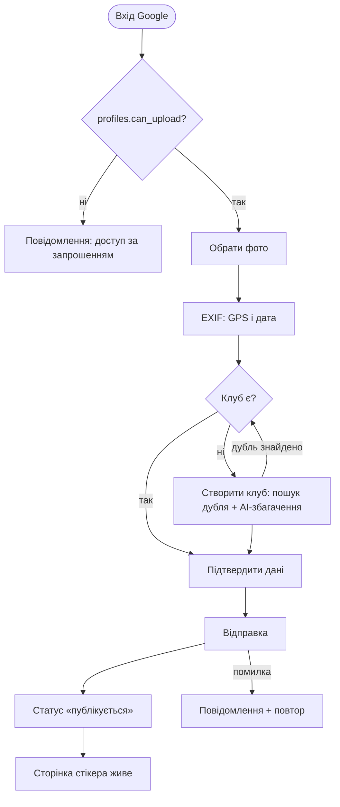

# StickerHunt 3.0 — Фаза 1: структура, потоки, стани (сторінка стікера)

**Статус:** ЧЕРНЕТКА від 2026-10-25. Скіли: `information-architecture`, `user-flow-diagram`, `state-machine`. Основа: `3.0-phase1-sticker-page-brief.md`. Коду немає.

## 1. Структура (IA)

### Місце сторінки в ієрархії
Існуюча: Континент > Країна > Клуб > Стікер (+ міста як перетин). Лишається без змін, URL не чіпаємо. Хлібні крихти Country > Club > Sticker уже є в статичному HTML.

### Модель контенту
| Сутність | Атрибути (з БД 25.10) | Новий звʼязок у 3.0 |
|---|---|---|
| Sticker | id, image_url, club_id, location, latitude, longitude, found, description, view_count, active | **author** (колонки нема, потрібна міграція `uploaded_by` → `profiles`) |
| Club | назва (з прапором у БД), країна, місто, сайт, хештеги | створюється внесником, якщо нема |
| Author (profiles) | id, `can_upload`, `can_edit` | публічний профіль, `is_seed` (внутрішній) |
| Country / City | коди, словники в 3 файлах | без змін |

### Ієрархія екрана (за важливістю для фана)
1. Стікер (зображення, домінує перший екран)
2. Ідентичність: клуб + країна (посилання)
3. **Смуга «ще стікери цього клубу»** (головна дія)
4. Автор (компактний рядок → профіль)
5. Факти: де й коли знайдено
6. Карта (лише якщо є координати)
7. Схожі стікери (країна/місто)
8. Другорядне: вхід у квіз

### Навігація
- Глобальна: логотип, пошук клубу ❓, вхід. Мінімум, без попапів.
- Локальна: хлібні крихти Country > Club.
- Контекстна: смуга клубу, «також знайдено в місті», схожі зі країни, автор → профіль.
- Правило досяжності: з будь-якого стікера до сторінки клубу 1 тап, до іншого стікера цього клубу 1 тап.

### Мітки (EN, як зараз)
«More from <Club>», «Added by <name>», «Found in <city>», «Similar stickers». ❓ Підтвердити тексти при дизайні.

## 2. Потоки

### Потік A: фан з пошуку (основний)
```mermaid
flowchart TD
  A([Google: "[club] stickers"]) --> B[Сторінка клубу або стікера]
  B -->|вже стікер| C[Сторінка стікера]
  B -->|клуб| D[Тап по стікеру] --> C
  C --> E{Клієнтський шар готовий?}
  E -->|так| F[Смуга «More from club»]
  E -->|ні / JS не працює| G[Статичні посилання на клуб і схожі]
  F -->|тап по стікеру| C2[Інший стікер клубу] --> F
  F -->|кінець смуги| H[Сторінка клубу]
  C -->|тап по автору| I[Профіль автора]
  C -->|тап по клубу| H
  C -->|вхід у квіз| Q[Квіз]
```
Подія для метрики: перехід зі сторінки стікера на **інший** стікер (`sticker_next_opened`); знаменник: унікальні відвідувачі сторінки стікера.

### Потік B: внесник (за запрошенням)

Фонові процеси: запис у БД, розсилка події, генерація сторінки (хвилини), оптимізація зображень.

## 3. Стани

### 3.1 Сторінка стікера (рендер)
Стани: `static` → `enhancing` → `enhanced`; гілка `static_only` (шар не завантажився).
- Подія `DOMContentLoaded` → `enhancing` (статичний HTML уже повний і читабельний).
- Подія `shared.js` OK → `enhanced`; помилка або тайм-аут → `static_only`.
- Охоронці: `enhanced` не змінює розмір видимих блоків (бюджет CLS ≤ 0.1; блокам резервується висота).
- Заборонено: `enhanced` одночасно з `static_only`.

### 3.2 Смуга клубу
`idle` → `loading` → `loaded(n≥2)` | `single(n=1)` | `error`.
- `loaded`: показати стікери клубу, гортання по горизонталі.
- `single`: клуб має один стікер → показати сусідні клуби країни (не порожню смугу).
- `error`: лишити статичне посилання «All stickers of <club>»; без червоних банерів.

### 3.3 Автор
`unknown` (колонка ще не заповнена) | `seed` (показується як звичайний підпис) | `named` (ім'я + посилання на профіль).
- Заборонено: показувати битий профіль-лінк; архівні стікери без автора мають нейтральний підпис.

### 3.4 Мапа
`no_coords` → блок прихований без «дірки»; `has_coords` → мапа підвантажується ліниво.

### 3.5 Знятий стікер
`active=false` або видалений → 301 на сторінку клубу. ❓ Потрібно вирішити механізм: правила в `vercel.json` чи видалення HTML. Клієнтський редирект не підходить (SEO).

### 3.6 Внесник (форма додавання)
`signed_out` → `signed_in_no_access` | `signed_in_can_upload` → `photo_selected` → `exif_parsing` → `club_pick` → (`club_create`) → `submitting` → `pending_generation` → `live`; помилки з кожного кроку ведуть у `error_retry`, дані форми зберігаються.
- Охоронець: кнопка відправки неактивна, поки не вибрано клуб (закриває відомий борг «рядок без клубу пропускається мовчки»).
- Охоронець: `submitting` не повторюється двічі (ідемпотентність).

## 4. Заборонені комбінації
- Смуга клубу `loaded` і `error` одночасно.
- Автор `named` без профілю.
- `enhanced` без повного статичного HTML.
- Відправка стікера без клубу.

## 5. Відкриті питання
1. ❓ Механізм 301 для знятих стікерів.
2. ❓ Глобальний пошук клубу в шапці: так чи ні (антиреференс «фільтри-форми» не про це, але прохання «легко»).
3. ❓ Подія в PostHog: назва, точка відліку.
4. ❓ Скільки стікерів у смузі за один показ і як працює «довантаження».
